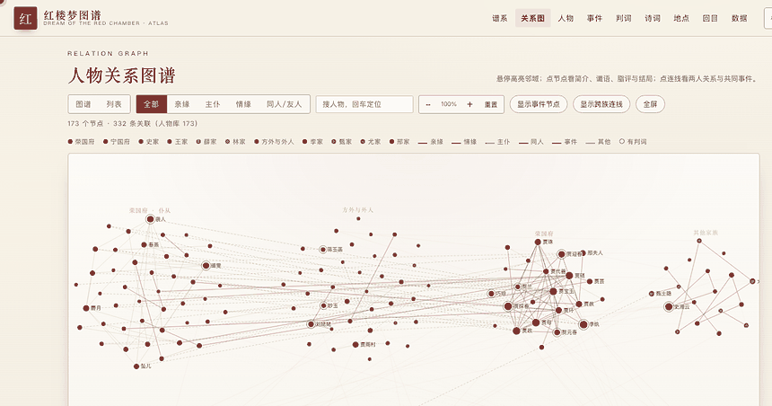

# Honglou Atlas · Dream of the Red Chamber

<p align="center">
  
</p>

<p align="center">
  <a href="https://iihao.github.io/honglou-atlas/"><b>▶ Live demo (no install)</b></a>
  &nbsp;·&nbsp;
  <a href="https://iihao.github.io/honglou-atlas/en/">English landing page</a>
  &nbsp;·&nbsp;
  <a href="README.md">中文说明</a>
  &nbsp;·&nbsp;
  
  
  <a href="https://github.com/iihao/honglou-atlas/stargazers"></a>
</p>

> The only open, searchable, clickable atlas of *Dream of the Red Chamber* (红楼梦) — **173 characters,
> 870 typed relations, a full genealogy** — reproducible in one command, zero frontend dependencies.

**If this project saves you from re-reading the novel to look someone up, a ⭐ Star is the best way to
say thanks — and it helps other readers find it.**

## What's inside

| Category | Count |
|---|---:|
| Characters | 173 |
| Relations (typed, labelled) | 870 |
| Genealogy nodes | 50 (five clans + servants) |
| Fates (判词) | 15 |
| Poems | 28 |
| Events / chapters / places | 51 / 64 / 29 |
| Wordplay (谐音/反语) | 34 |
| Fates vs. endings (谶语对照) | 16 |
| Mapped rooms (宁荣二府 · 大观园) | 26 |

## Three things worth a look

- **Names are puns.** 甄士隐 = “真事隐” (true matters hidden), 贾雨村 = “假语村言” (fiction),
  元春/迎春/探春/惜春 = “原应叹息” (sigh after all), 单聘仁 = “善骗人” (good at cheating).
  Each of the 34 entries notes the chapter and whether the reading is standard, "one theory" or disputed.
- **Prophecy vs. ending.** Every 判词 is paired with what it foretold and what actually happens in the
  text, tagged *fulfilled within the 80 chapters* / *resolved only by the 1791 sequel* / *unsettled*.
- **Estate map.** 宁国府 east of the street, 荣国府 west of it, the garden north-east of 荣国府 — with
  each courtyard's owner and the chapter that justifies its position.

## Why this exists

*Dream of the Red Chamber* has hundreds of characters across the Jia, Shi, Wang, Xue and Lin clans, and
the relationships are the hard part of reading it. This project turns the genealogy and relationship
graph into something you can **click, search, and follow**. Three things that set it apart:

- **The genealogy is not a plain tree.** Every node is annotated with birth order (eldest son, second
  daughter…), title/office, and branch (长房/二房/旁支); those who inherit a title get a crown mark,
  legitimate vs. concubine-born children are distinguished, and siblings are ordered by age.
- **Relations are weighted.** Two people can be siblings *and* poetry-club members at once; only one line
  is drawn, showing the highest-weight relation (kinship > marriage > service > club > event), and the
  rest are listed in the relation card.
- **Data is reproducible and sourced.** 360 entries carry references (820+ source items), with links to
  Wikipedia and Baidu Baike on 44 key entries. Disputed endings are marked 「一说」/「探佚」, never stated
  as fact.

## Features

- **Genealogy** (`#lineage`): generation-by-generation trees for the Jia (Ning & Rong), Shi, Wang, Xue and
  Lin clans; spouses linked by dashed lines; unknown-name nodes are auto-generated.
- **Relationship graph** (`#graph`): graph **or list** view — the list groups every relation by kinship /
  service / romance / friendship, searchable and clickable; fullscreen mode (`F` to toggle, `ESC` to exit,
  floating toolbar for zoom); clustered layout by clan × master/servant; filters; labels on hover.
- **Characters**: click a person for their bio, fate (判词 with plain-language gloss), 脂评 (Zhiyanzhai's
  marginalia), ending, and related events.
- **Click an edge** to see what the two people are to each other (with the reverse term shown on the other
  person's page) and the events they share.
- **Events** split into *appears* (curated) and *mentioned* (auto-matched from event text).
- **Search** by name *or* by 别号 (alias) — e.g. searching 蕉下客 lands on 探春 (Tanchun).

> Note: the interactive demo itself is in Chinese (the source text is classical Chinese and is best kept
> as-is). The [English landing page](https://iihao.github.io/honglou-atlas/en/) explains the project, the
> data, and how to use each view.

## Quick start

```bash
python3 tools/build_seed.py     # build db/seed.json
python3 db/init_db.py --force   # build db/honglou.db
./start.sh                      # http://127.0.0.1:8600
```

Static export (for GitHub Pages / any CDN):

```bash
python3 tools/build_static.py   # -> dist/
```

## Structure

```
index.html           single-page entry
css/style.css        styles
js/app.js            frontend (genealogy, graph, entries, search)
en/index.html        English landing page
server/app.py        local API + static file server
db/schema.sql        SQLite schema
db/init_db.py        seed.json -> SQLite
db/seed.json         generated data
tools/build_seed.py  data build script
tools/enrich_data.py entry enrichment data
```

## Data & sources

Entry text is written by the project itself, with references to the original novel (庚辰本 / 程乙本) and
standard scholarship (《红楼梦大辞典》, the People's Literature Press annotated edition, 蔡义江's poetry
commentary, 俞平伯, 周汝昌, 王昆仑, 余英时, 张爱玲, etc.). Disputed material — 脂批 readings, textual
variants, 探佚 and "Qin studies" — is explicitly marked, never presented as settled fact.

Online reference links point to Wikipedia (CC BY-SA 4.0) and Baidu Baike; the project only takes factual
clues from them and writes its own entry text.

## Contributing

See [CONTRIBUTING.md](CONTRIBUTING.md) — how to add characters, relations, events and genealogy, plus the
pre-commit self-check. Data is plain Python (standard library only); no database knowledge required.

## License

Code: **MIT** (see [LICENSE](LICENSE)). The novel itself is in the public domain; summaries, analysis and
structural data are original to this project.
